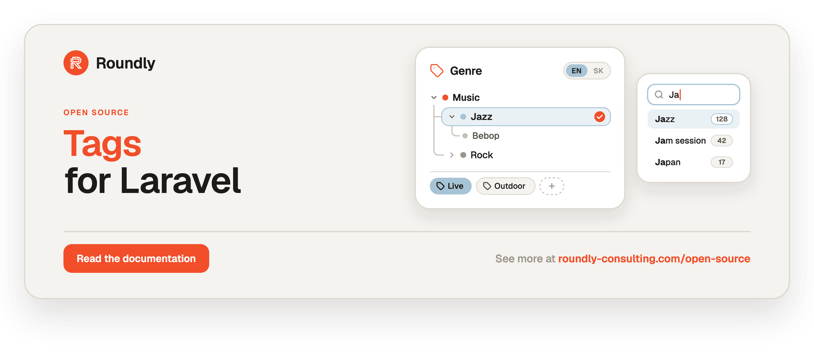

<!-- roundly-hero:start -->
<p align="center">
  <a href="https://roundly-consulting.com/open-source/docs/tags-for-laravel?utm_source=github&utm_medium=readme&utm_campaign=open-source&utm_content=tags-for-laravel">
    
  </a>
</p>
<!-- roundly-hero:end -->

<!-- roundly-badges:start -->
<p align="center">
  <a href="https://packagist.org/packages/roundly-consulting/tags-for-laravel"></a>
  <a href="https://github.com/roundly-consulting/tags-for-laravel/actions/workflows/run-tests.yml"></a>
  <a href="https://github.com/roundly-consulting/tags-for-laravel/actions/workflows/fix-php-code-style-issues.yml"></a>
  <a href="https://donate.stripe.com/dRmeVe8FX5PF1Qd9pXcEw00"></a>
  <a href="https://www.patreon.com/cw/roundly"></a>
  <a href="https://roundly-consulting.com/support-us?utm_source=github&utm_medium=readme&utm_campaign=open-source&utm_content=tags-for-laravel#crypto"></a>
</p>
<!-- roundly-badges:end -->

# Tags for Laravel

Typed taxonomies for any Eloquent model: flat labels or nested category trees, single- or
multi-select, curated or free-form, global or tenant-scoped, and translatable in every locale —
with autocomplete, usage counts and query scopes that never N+1.

## Installation

Requires PHP 8.4, Laravel 12 or 13, and PostgreSQL 12+ or MySQL 8.0.23+.

```bash
composer require roundly-consulting/tags-for-laravel
php artisan vendor:publish --tag="tags-migrations"
php artisan migrate
```

## Usage

Make a model taggable:

```php
use Illuminate\Database\Eloquent\Model;
use RoundlyConsulting\Tags\Concerns\HasTags;
use RoundlyConsulting\Tags\Contracts\Taggable;

final class Concert extends Model implements Taggable
{
    use HasTags;
}
```

Declare your types, build a tree, tag, query and suggest:

```php
use RoundlyConsulting\Tags\Facades\Tags;

// Declare your tag types once, in a service provider
Tags::define('genre')->hierarchical()->single();   // a curated category tree, one per model
Tags::define('label')->max(5);                     // free-form labels, up to five

// Build the tree (names are translatable; a plain string is the current locale)
$music = Tags::type('genre')->make(['en' => 'Music', 'sk' => 'Hudba'])->color('#f24e29')->create();
$jazz = Tags::type('genre')->make('Jazz')->under($music)->create();

// Tag any model that uses HasTags
$concert->syncTags($jazz, 'genre');
$concert->attachTags(['Live', 'Outdoor'], 'label');     // unknown labels are created on the fly

// Query: "music" also matches everything under it
Concert::withAnyTags(['music'], 'genre', descendants: true)->get();
Concert::withAllTags(['live', 'outdoor'], 'label')->get();

// Read without N+1
foreach (Concert::with('tags')->get() as $concert) {
    echo $concert->tagOf('genre')?->name;                         // Jazz
    echo $concert->tagsOf('label')->pluck('name')->join(', ');    // Live, Outdoor
}

// Autocomplete and popularity
Tags::type('label')->suggest('liv');    // prefix matches first, in every locale
Tags::type('label')->popular(10);
```

<!-- roundly-docs:start -->
## Documentation

The full documentation — configuration, every feature and its API, and testing — lives on our
website: **[roundly-consulting.com/open-source/docs/tags-for-laravel](https://roundly-consulting.com/open-source/docs/tags-for-laravel?utm_source=github&utm_medium=readme&utm_campaign=open-source&utm_content=tags-for-laravel)**

Release notes are in [CHANGELOG.md](CHANGELOG.md). To contribute, see the
[contributing guide](https://github.com/roundly-consulting/.github/blob/main/CONTRIBUTING.md).
<!-- roundly-docs:end -->

<!-- roundly-support:start -->
## Support our work

This package is free and open source, built and maintained by
[Roundly Consulting](https://roundly-consulting.com/open-source?utm_source=github&utm_medium=readme&utm_campaign=open-source&utm_content=tags-for-laravel).
If it saves you time, please consider supporting our open-source work — a one-time donation, a
monthly pledge on Patreon or a crypto donation helps fund maintenance, new features and new
packages.

<a href="https://donate.stripe.com/dRmeVe8FX5PF1Qd9pXcEw00"></a>
<a href="https://www.patreon.com/cw/roundly"></a>
<a href="https://roundly-consulting.com/support-us?utm_source=github&utm_medium=readme&utm_campaign=open-source&utm_content=tags-for-laravel#crypto"></a>
<!-- roundly-support:end -->

## License

The MIT License (MIT). See [LICENSE.md](LICENSE.md).
